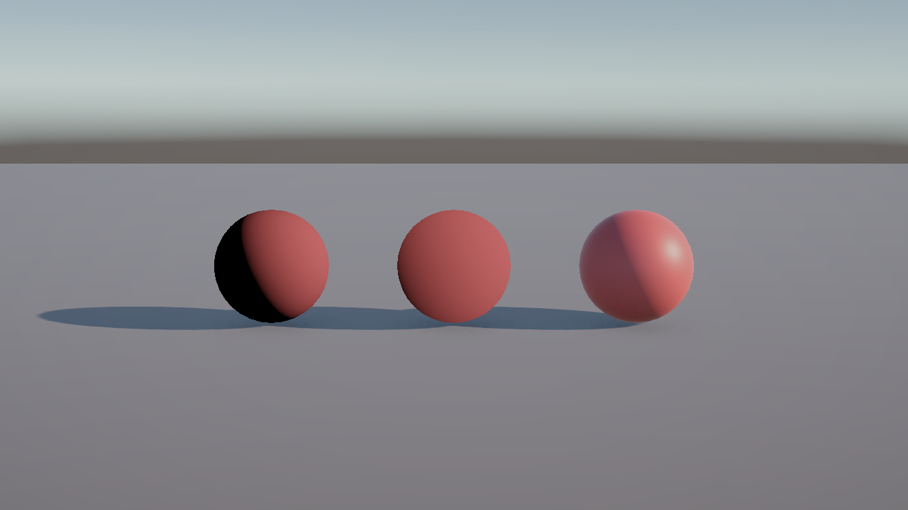

# はじめに
プログラムワークショップⅣの4つ目の管理用です

# 結果画像

- 左：Unlit Shader Graphで作ったランバート拡散反射（Main Light Direction と Normal Vector(World) の内積 × -1 → Maximum(0) → Albedo を乗算）
- 右：Lit Shader Graph（Albedo を Base Color につないだだけ）

- 工夫した点：ランバートを改造してハーフランバート（×0.5+0.5 して 0〜1 に収める）のシェーダーグラフも作ってみた（Assets/Shaders/HalfLambert.shadergraph）。ランバートは光が当たらない側が真っ黒になるが、ハーフランバートは裏側まで明るさがなだらかに変化するので、影の部分がつぶれにくかった。Litは環境光やスペキュラ、自己影が入るので、ランバートと比べると影側も少し明るく、ハイライトも出ている。
- ランバートの Multiply(-1) と Maximum(0) をサブグラフ（Assets/Shaders/LambertClamp.shadersubgraph）にまとめて、ランバートのグラフではそのサブグラフのノードを使うようにした。見た目は変わらない。

# 進め方

- 本リポジトリをforkしてください。
- fork先のリポジトリを更新してください
- Unityのプロジェクトをsrc内で進めて下さい。
- 結果を画面キャプチャして、画像としてリポジトリに追加して、上記のリンクから見れるようにしてください。
- 完成したら本リポジトリのmainブランチにpull requestを投げてください

